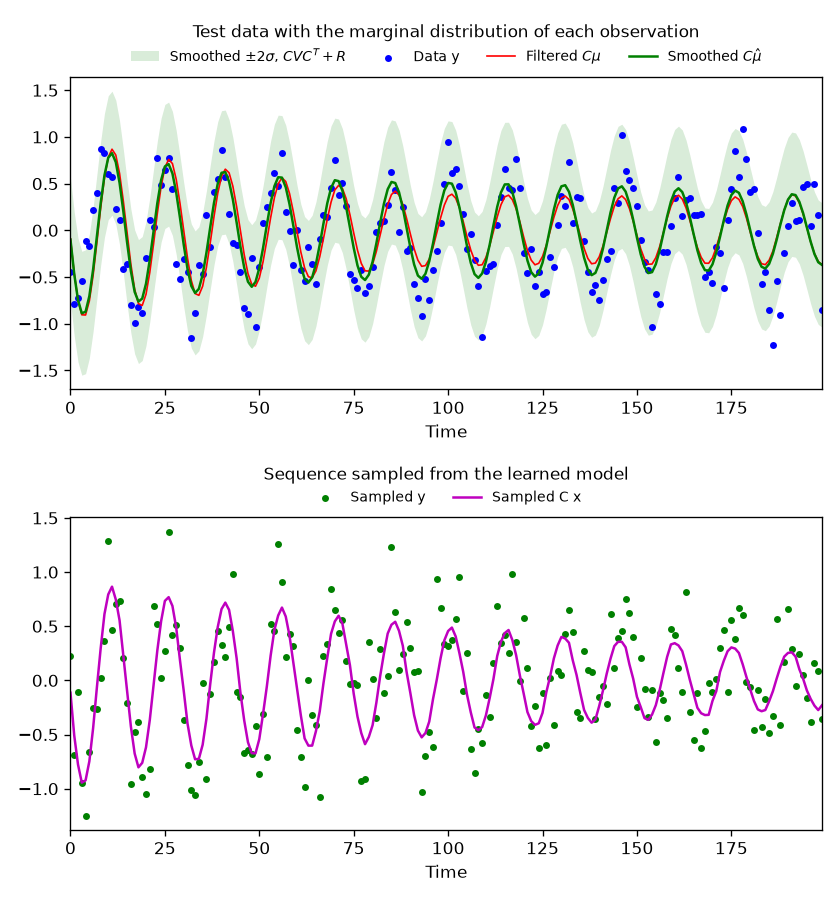
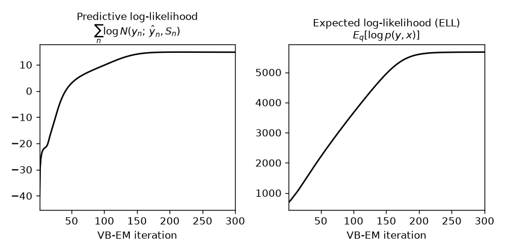

# VBLDS: Variational Bayesian Linear Dynamical Systems

Variational inference and learning for Bayesian linear dynamical systems (linear
Gaussian state space models), in MATLAB and Python (NumPy). It accompanies the paper

> J. Neri, R. Badeau, P. Depalle, "[Probabilistic Filter and Smoother for Variational Inference of Bayesian Linear Dynamical Systems](https://ieeexplore.ieee.org/abstract/document/9054206),"
> *IEEE International Conference on Acoustics, Speech, and Signal Processing (ICASSP)*,
> pp. 5885–5889, Barcelona, Spain, 2020.

Given one or more observed sequences, the code learns the system matrices
$A, Q, C, R$ and infers the latent state sequence. It treats $A, Q, C, R$ as
random variables and runs variational Bayesian EM. The E-step is a Kalman filter
and Rauch–Tung–Striebel smoother modified to account for the remaining
uncertainty in the parameters. The paper calls this the *Bayesian Kalman filter
and smoother*.

## Model

For $n = 1, \dots, N$, with latent state $x_n \in \mathbb{R}^{D_x}$,
observation $y_n \in \mathbb{R}^{D_y}$ and optional known input
$u_n \in \mathbb{R}^{D_u}$ (paper, Eq. 1–6):

$$
\begin{aligned}
x_1 &\sim \mathcal{N}(m_0, P_0) \\
x_n &= A\,x_{n-1} + B\,u_n + w_n, & w_n &\sim \mathcal{N}(0, Q) \\
y_n &= C\,x_n + D\,u_n + v_n, & v_n &\sim \mathcal{N}(0, R)
\end{aligned}
$$

All of $A, B, C, D, Q, R$ are random with a prior. $Q$ and $R$ are general
covariance matrices, and the filter and smoother work with any prior on the
parameters. They only need expectations such as $\langle Q^{-1}\rangle$ and
$\mathbb{E}[A^\top Q^{-1} A]$ (paper, Sec. 2–3).

**This implementation does not support inputs yet:** it fits the model with
$B = D = 0$, i.e. no $u_n$. It offers two conjugate priors, chosen with the
`covariance` option:

| `covariance`           | $Q$, $R$ | Prior |
| ---------------------- | -------- | ----- |
| `'diagonal'` (default) | diagonal | Each row of $A$ ($C$) is Gaussian with ARD precisions `alpha` (`beta`); each diagonal precision of $Q$ ($R$) is Gamma. This is the prior suggested in the paper. |
| `'full'`               | full     | Matrix-normal–Wishart on $(A, Q)$ and on $(C, R)$. The ARD precisions are shared by all rows. |

Use `'full'` when the noise is correlated across dimensions; a diagonal model
pushes that correlation into the latent states instead. The Wishart priors are
matched to the Gamma priors, so with equal ARD precisions the diagonal of a
`'full'` update equals the `'diagonal'` update. In both modes the
hyperparameters are set very small, so the priors are close to
non-informative, and $m_0$ and $P_0$ are point estimates.

Each iteration of VB-EM:

1. **E-step: Bayesian Kalman filter and smoother** (`vblds_infer`). This is a
   forward filter and backward smoother that uses the expected parameters plus
   two correction matrices:
   - `Sigma_AQA` $= \mathbb{E}[A^\top Q^{-1} A] - \langle A\rangle^\top \langle Q^{-1}\rangle \langle A\rangle$
   - `Sigma_CRC` $= \mathbb{E}[C^\top R^{-1} C] - \langle C\rangle^\top \langle R^{-1}\rangle \langle C\rangle$

   Each step multiplies by a gain $(I + V\Sigma)^{-1}$, computed with the
   Woodbury identity. If both corrections are zero, this is exactly the
   standard Kalman filter and RTS smoother.
2. **M-step: variational parameter update** (`vblds_learn`). Updates the
   posteriors over $A, Q$ and $C, R$ (Normal–Gamma per row, or
   matrix-normal–Wishart) and the correction matrices, using the smoothed moments
   $\mathbb{E}[x_n]$, $\mathbb{E}[x_n x_n^\top]$ and $\mathbb{E}[x_{n-1} x_n^\top]$.

Progress is tracked with the **expected log-likelihood** (ELL),
$\mathbb{E}_{q(x)}[\log p(y, x \mid \hat\theta)]$ at the current point
estimates of the parameters. It is not the full variational lower bound,
because it leaves out the prior and entropy terms.

## Implementations

| Folder               | Language | Data                    | Notes                                     |
| -------------------- | -------- | ----------------------- | ----------------------------------------- |
| [`matlab/`](matlab)  | MATLAB   | one sequence            | Reference implementation, one file per step |
| [`python/`](python)  | NumPy    | one sequence            | Same algorithm as a `VBLDS` class; see [python/README.md](python/README.md) |

Both implementations support multi-dimensional observations (`dimy > 1`) and
latent states, and both `covariance` modes.

Both use the paper's notation: `y` for observations and `x` for latent states,
with dimensions `dimy` and `dimx`.

## MATLAB quick start

Requires MATLAB only; no toolboxes are needed. From the `matlab/` folder:

```matlab
demo
```

`demo.m` generates a noisy 1-D sinusoid from a 2-D latent oscillator, then fits
an 8-dimensional VBLDS with 1000 VB-EM iterations, printing the ELL after each.
It plots:

- the data and the smoothed reconstruction $\langle C\rangle\,\mathbb{E}[x_n]$
- a new sequence sampled from the learned model
- the learned $A$, $Q$, $C$, $R$
- the smoothed latent states
- the ELL at each iteration

### Using it on your own data

```matlab
addpath('src', 'utils');
params = vblds_initialize(dimy, dimx, 'full'); % dimy = size(y,1), dimx = latent size;
                                                % 'full' or 'diagonal' (default) Q and R
for iter = 1:num_iters
    [mu, V, V12] = vblds_infer(y, params);      % E-step
    params = vblds_learn(y, mu, V, V12, params); % M-step
    ell(iter) = vblds_ell(y, mu, V, V12, params);
end
[y_new, x_new] = vblds_sample(params, 200);     % generate from the learned model
```

`y` is `dimy x N`. `params` is a struct with fields `A, Q, C, R, m0, P0,
Sigma_AQA, Sigma_CRC, covariance`.

| Function            | Purpose                                                        |
| ------------------- | -------------------------------------------------------------- |
| `vblds_initialize`  | Initial parameter struct                                       |
| `vblds_infer`       | E-step: runs the filter, then the smoother, over the sequence  |
| `vblds_update`      | One filter update step (condition on `y_n`)                    |
| `vblds_predict`     | One filter prediction step                                     |
| `vblds_smooth`      | One backward smoothing step                                    |
| `vblds_learn`       | M-step: variational update of all parameters                   |
| `vblds_ell`         | Expected log-likelihood                                        |
| `vblds_sample`      | Draws a sequence from the model                                |

Run `help <function>` in MATLAB for its inputs and outputs.

## Python quick start

```bash
cd python
uv run train.py
uv run evaluate.py
```





See [python/README.md](python/README.md) for details and the `VBLDS` API.

## Repository layout

```
matlab/
  demo.m                   Demo script (start here)
  src/                     VBLDS algorithm (see table above)
  data/data_loader.m       Generates synthetic test sequences
  utils/                   Woodbury inverse, symmetrize, Gaussian/Laplace sampling and plotting helpers
docs/                      Figures shown in this README
python/
  train.py, evaluate.py    Train on synthetic data, then evaluate and plot
  pyproject.toml, uv.lock  Dependencies; run the scripts with `uv run`
  model/vblds.py           VBLDS model (NumPy)
  data/data_loader.py      Generates synthetic test sequences
  utils/utils.py           Helpers
```

## Citation

```bibtex
@inproceedings{neri2020vblds,
  author    = {Neri, Julian and Badeau, Roland and Depalle, Philippe},
  title     = {Probabilistic Filter and Smoother for Variational Inference of Bayesian Linear Dynamical Systems},
  booktitle = {IEEE International Conference on Acoustics, Speech and Signal Processing (ICASSP)},
  pages     = {5885--5889},
  address   = {Barcelona, Spain},
  year      = {2020},
  doi       = {10.1109/ICASSP40776.2020.9054206}
}
```

## License

GPL-3.0. See [LICENSE](LICENSE).
