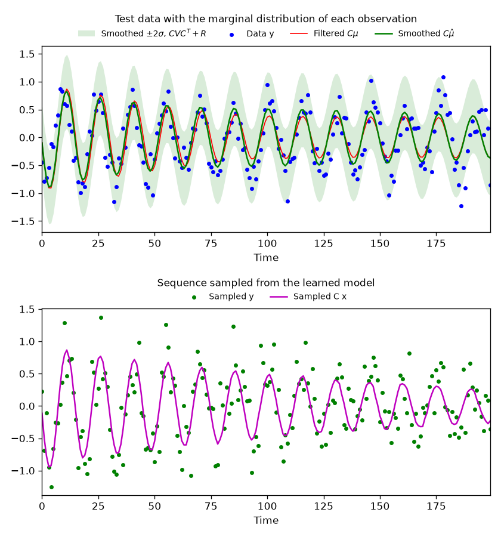
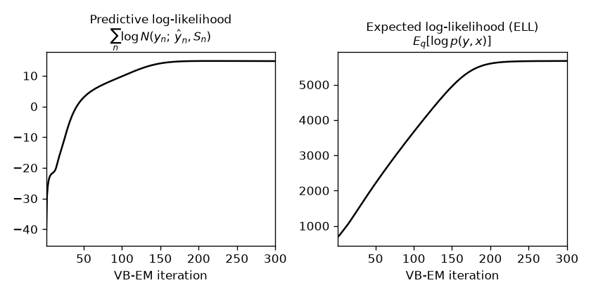

# VBLDS in Python

A NumPy implementation of variational Bayesian learning for linear dynamical
systems. See the [top-level README](../README.md) for the model and the
algorithm. All parameter updates are closed-form, so no autodiff framework is
needed.

Notation follows the paper and the MATLAB code: `y` is the observations and
`x` the latent states. `dimy` is the observation dimension and `dimx` the
latent dimension.

## Requirements

Python 3.10 or newer with `numpy` and `matplotlib` (matplotlib is only used by
`evaluate.py`).





## Quick start

From this folder (`vblds/python`), with [uv](https://docs.astral.sh/uv/):

```bash
uv run train.py      # fits the model, saves saves/model.npz
uv run evaluate.py   # loads it, writes figures to results/
```

The first `uv run` creates a `.venv/` here and installs the versions pinned in
`uv.lock`. Later runs reuse it. This folder is not an installable package;
`pyproject.toml` only lists the dependencies.

Without uv, install the two dependencies in any environment and run the
scripts with Python:

```bash
pip install numpy matplotlib
python train.py
python evaluate.py
```

| Script        | What it does |
| ------------- | ------------ |
| `train.py`    | Samples a 100-step training sequence from a known 2-D oscillator LDS (`data/data_loader.py`), fits an 8-dimensional VBLDS with 300 VB-EM iterations, and saves it to `saves/model.npz` and its training curves to `saves/history.npz`. Set `COVARIANCE` at the top to `'full'` to learn full Q and R. |
| `evaluate.py` | Samples a new 200-step sequence from the same kind of system, runs the trained model's filter and smoother on it, draws a new sequence from the learned model, and saves `results/results.png` (first figure above: data with the filtered and smoothed estimates and a ±2σ band, and a generated sequence), `results/training.png` (second figure: the training curves) and `results/learned_parameters.png` (A, Q, C, R). |

Both scripts are seeded, so repeated runs give the same results.

## Using the model

```python
from model.vblds import VBLDS

y = ...                                      # observations, shape (dimy, N)
model = VBLDS(dimy=y.shape[0], dimx=8)       # covariance='full' for full Q, R
history = model.fit(y, iterations=200)       # history.ell, history.loglik per iteration

result = model(y)                            # one more iteration, with outputs
y_hat = model.C @ result.mus                 # smoothed reconstruction
y_new, x_new = model.sample(N=500)           # generate from the learned model

model.save('model.npz')
model = VBLDS.load('model.npz')
```

`VBLDS(dimy, dimx, covariance='diagonal', rng=None)`:

- `covariance`: `'diagonal'` or `'full'` noise covariances Q and R (see the
  [top-level README](../README.md#model)).
- `rng`: a seed or `numpy.random.Generator`, used for the random initial A and
  C and by `sample`.

Each call to `model(y)` (or `model.step(y)`) runs **one full VB-EM
iteration**: the Bayesian Kalman filter, the smoother, then the variational
parameter update, in place. `fit` runs several and returns the `ell` and
`loglik` of each.

`model(y)` returns a named tuple with these fields:

| Field | Shape | Meaning |
| ----- | ----- | ------- |
| `ell`  | scalar          | Expected log-likelihood after the update |
| `loglik` | scalar        | Log-likelihood under the filter's one-step predictions, Σₙ log N(y_n; ŷ_n, S_n) (parameters before the update) |
| `muf`  | (dimx, N)       | Filtered means E[x_n \| y_{1:n}] |
| `Vf`   | (dimx, dimx, N) | Filtered covariances |
| `mus`  | (dimx, N)       | Smoothed means E[x_n \| y_{1:N}] |
| `Vs`   | (dimx, dimx, N) | Smoothed covariances |
| `V12`  | (dimx, dimx, N-1) | Smoothed cross-covariances Cov(x_n, x_{n+1}) |
| `y_pred` | (dimy, N)     | One-step predicted means ŷ_n = E[y_n \| y_{1:n-1}] |
| `S`    | (dimy, dimy, N) | One-step predicted covariances S_n |

The marginal distribution of each observation under the filtered or smoothed
posterior has mean `C @ mu` and covariance `C V Cᵀ + R`; `evaluate.py` plots
it as a ±2σ band.

`loglik` is the better convergence check. The ELL keeps rising as Q shrinks
toward zero, because its −½(N−1)·log|Q| term grows, while `loglik` levels
off once the predictions stop improving.

Model attributes: `A`, `Q`, `C`, `R`, `m0`, `P0` (the expected parameters)
and `Sigma_AQA`, `Sigma_CRC` (corrections for parameter uncertainty), all
NumPy arrays. The prior hyperparameters are `alpha`, `beta` (ARD precisions on
A and C) and `a, b, c, d` (Gamma priors on the noise precisions, which also
set the matched Wishart priors in `'full'` mode). They are set in `__init__`
and can be changed before fitting.

## Layout

```
train.py              Training script
evaluate.py           Evaluation and plotting script
pyproject.toml        Dependencies, for uv (not a package definition)
uv.lock               Exact dependency versions used by uv run
model/vblds.py        VBLDS class
data/data_loader.py   load_data(N, rng): samples from a known 2-D oscillator LDS
utils/utils.py        get_phasor, plot_matrix
```
